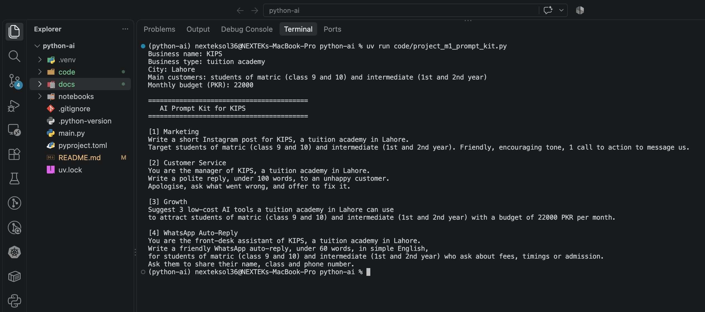
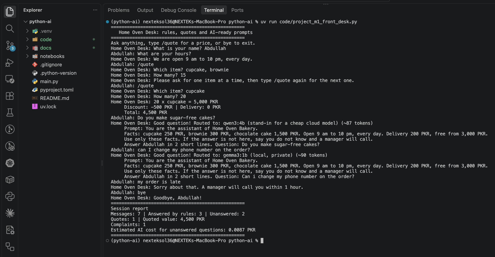
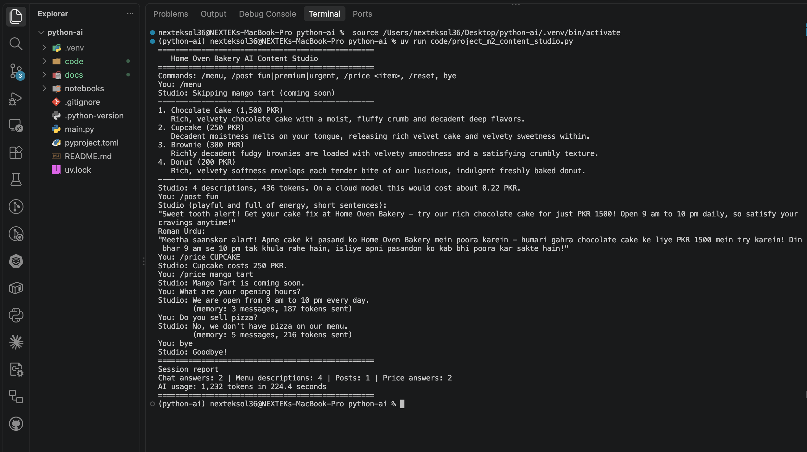

# python-ai

I am Muhammad Abdullah Akbar. This repo is my work for the Python for AI course (Module 1: Python Basics for GenAI and Agentic AI, and Module 2: Core Python for Building LLM Apps).

**My AI goal:** become an AI Agent Developer.

## How to run

```bash
uv run main.py
```

Every lesson script lives in `code/`. Run any of them from the repo root:

```bash
uv run code/lesson_01_intro.py
```

The Module 2 scripts (`lesson_2_*.py` and `project_m2_content_studio.py`) talk to a real AI model on my own laptop through [Ollama](https://ollama.com). Before running them:

```bash
uv sync                 # installs langchain and langchain-ollama from uv.lock
ollama pull llama3.2    # downloads the model (about 2 GB)
ollama serve            # only if the Ollama app is not already running
```

Each AI answer takes a while on my laptop, because the model runs on the CPU.

## Module 1 Project: AI Prompt Kit

A Python tool that turns a local business's details into 4 ready-to-use AI prompts.

**Run:** `uv run code/project_m1_prompt_kit.py`



**Who would pay for this:** small business owners in Pakistan, like tuition academies and shops, who want AI help but don't know what to type.

## Module 1 Final Project: AI Front Desk

A front desk assistant for a local bakery (example business). It answers common questions with free rules, gives exact price quotes with `/quote` (bulk discount and delivery fee), turns every question it cannot answer into a clean AI prompt routed to a local or cloud-style model with a cost estimate, and ends with a session report for the owner.

**Run:** `uv run code/project_m1_front_desk.py`



**Who would pay for this:** a bakery owner whose staff answer the same questions and work out price quotes by hand all day. The desk answers the easy questions instantly, quotes prices the same way every time, and the session report shows which questions it could not answer. I have not measured how much time this saves.

Design, rule tests and AI tests: `docs/project-m1-part2-design.md` and `docs/project-m1-part2-results.md`. The business name, prices, hours and phone number are examples for practice.

## Module 2 Checkpoint 1 Project: AI Content Studio

A content studio for a local bakery (example business) that talks to a real AI model on my own laptop. `/menu` writes a description for every product, `/post <tone>` streams a social media post (plus a Roman Urdu version), `/price` answers from the data without the AI, and any other question is answered from real business facts with memory. It ends with a session report of what the AI did.

**Run:** `uv run code/project_m2_content_studio.py` (needs Ollama running with `llama3.2`, see the setup above)



**Who would pay for this:** a bakery owner with no time for marketing, whose menu has no descriptions and who keeps answering the same questions. The studio writes the menu and the posts in one run, answers prices from the real price list so the AI cannot make one up, and reports what it cost. I have not measured how much time or money this saves, and the small local model needs its writing checked by the owner.

Design, feature tests and AI tests: `docs/project-m2-cp1-design.md` and `docs/project-m2-cp1-results.md`. The business name, prices, hours and phone number are examples for practice.

## Task 1.8: KIPS Business Helper Bot (design)

A rule-based chatbot for KIPS tuition academy, Lahore. Run: `uv run code/lesson_08_mini_chatbot.py`

The fees, timings and reply texts are example details for practice, not KIPS's real ones. Rules are checked top to bottom and the first match wins.

| # | Intent (what the user wants) | Keywords to look for | Reply |
|---|---|---|---|
| 1 | Exit | bye, exit | Goodbye and chat summary |
| 2 | Human handover | human, agent | "Connecting you to a human..." and the chat ends |
| 3 | Complaint | refund, complaint, unhappy, delay, late | Manager will call today |
| 4 | Fees | fee, price, cost, how much | Matric and Intermediate monthly fees |
| 5 | Admission | admission, admit, enrol, register, join | Send name, class and phone number |
| 6 | Timings | timing, time, hour, open, schedule | Class timings |
| 7 | Location | where, location, address, branch | Lahore, ask the front desk |
| 8 | Subjects | subject, course, matric, intermediate, class | Matric and Intermediate classes |
| 9 | Greeting | hi, hello, salam, assalam | Friendly hello |
| 10 | Anything else | (no match) | Fallback: count it and print the AI prompt for Module 2 |

## Lessons done so far

| Task | What I built | Files |
|---|---|---|
| 1.1 Your AI Career Intro | Prints my name, dream role, a business problem and why | `code/lesson_01_intro.py` |
| 1.2 Toolkit Proof | Proof that my AI dev tools work, plus my first Ollama chat | `code/lesson_02_toolkit.py`, `docs/setup-check.png`, `docs/ollama-first-chat.md` |
| 1.3 Client-Ready Repo | This uv project with `code/`, `docs/`, `notebooks/` and a README | `main.py`, `pyproject.toml`, `uv.lock`, `.gitignore` |
| 1.4 Business Prompt Builder | Asks for business details and builds an AI prompt | `code/lesson_04_print_input.py`, `docs/prompt-test.md` |
| 1.5 AI Model Profile Card | Model profile with `str`, `int`, `float` and `bool`, and a cost estimate | `code/lesson_05_variables.py` |
| 1.6 Prompt Cleaner | Cleans a messy name and question, estimates tokens, builds a prompt | `code/lesson_06_strings_prompts.py` |
| 1.7 Smart Model Router | Picks a model for code, private or chat tasks and estimates the cost | `code/lesson_07_conditions.py` |
| 1.8 Business Helper Bot | Rule-based chatbot for KIPS (design table above) | `code/lesson_08_mini_chatbot.py` |
| 2.1 AI Tutor | Asks for a topic and level, calls a local AI model and prints the answer with tokens and time. Stretch: the Module 1 Prompt Kit now sends Prompt 1 to the AI | `code/lesson_2_1_first_ai_call.py`, `code/project_m1_prompt_kit.py` |
| 2.2 Personal Tutor with Memory | Chat that remembers the conversation in a list, with `/reset`, `/count`, trimmed memory and tokens sent per answer. Stretch: summary of the questions asked | `code/lesson_2_2_chat_memory.py` |
| 2.3 Persona Bot with Real Facts | Bakery assistant grounded in a facts dictionary, with switchable personas, `/price` answered without the AI, and `/add` to extend the menu | `code/lesson_2_3_persona_bot.py` |
| 2.4 Batch Product Writer | One loop writes an AI description for every product, skips the item with no price, and reports tokens and time. Stretch: bot battle, rules against AI on 6 questions | `code/lesson_2_4_batch_writer.py`, `code/lesson_2_4_bot_battle.py` |

Also done:

- Module 1 Checkpoint 1 quick checks: `docs/my-answers-module-1.md`
- Module 1 Checkpoint 1 project (AI Prompt Kit): `code/project_m1_prompt_kit.py` and `docs/project-m1-results.md`
- Module 1 Checkpoint 2 quick checks: `docs/my-answers-module-1.md`
- Module 1 Checkpoint 2 project (AI Front Desk): `code/project_m1_front_desk.py`, `docs/project-m1-part2-design.md` and `docs/project-m1-part2-results.md`
- Module 2 Checkpoint 1 project (AI Content Studio): `code/project_m2_content_studio.py`, `docs/project-m2-cp1-design.md` and `docs/project-m2-cp1-results.md`
